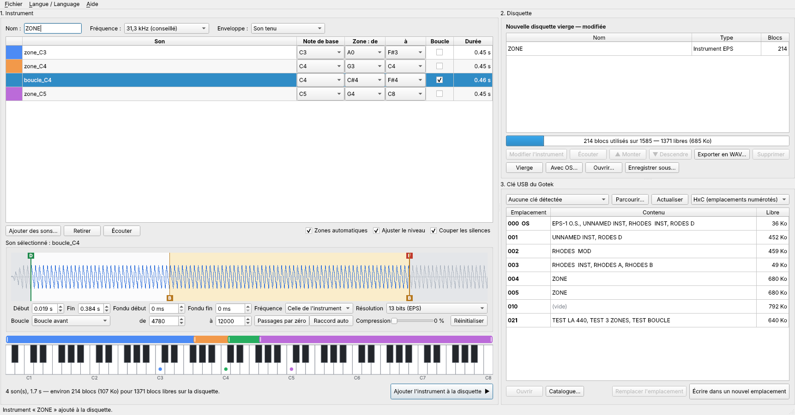

# EPS Builder

*[English version](README.md)*

   
  Ensoniq EPS — photo de Johnrpenner, <a href="https://commons.wikimedia.org/wiki/File:Ensoniq_EPS_Photo.jpg">Wikimedia Commons</a>,
  <a href="https://creativecommons.org/licenses/by-sa/3.0/deed.fr">CC BY-SA 3.0</a>

EPS Builder transforme des fichiers audio en instruments pour l'échantillonneur **Ensoniq EPS**,
les range sur des disquettes virtuelles (`.hfe`) et gère la clé USB d'un lecteur **Gotek**
(firmware HxC ou FlashFloppy). Les instruments sont au format EPS classique, relu aussi par
l'EPS-16+ et l'ASR-10.

L'application existe en français et en anglais (menu *Langue / Language*).

## L'Ensoniq EPS

L'**EPS** (*Ensoniq Performance Sampler*) est un clavier échantillonneur fabriqué par Ensoniq à
Malvern, en Pennsylvanie, de 1988 à 1991, pour succéder au Mirage. Il doit le mot
« Performance » de son nom à une fonction rare à l'époque : on peut charger de nouveaux sons
depuis la disquette tout en continuant à jouer ceux qui sont déjà en mémoire.

| | |
|---|---|
| **Échantillonnage** | 13 bits, entrée mono, fréquences de 6,25 kHz à 52 kHz |
| **Polyphonie** | 20 voix à 31,2 kHz, 16 à 39 kHz, 12 à 52 kHz |
| **Clavier** | 61 touches, vélocité et aftertouch polyphonique, deux boutons de sélection de patch |
| **Instruments** | 8 chargés à la fois, chacun avec jusqu'à 8 layers et 127 sons |
| **Synthèse par son** | deux filtres, trois enveloppes (hauteur, filtre, amplitude), LFO, sources de modulation assignables |
| **Mémoire** | 256 K mots d'échantillons, extensible par des cartes 2x et 4x |
| **Stockage** | disquettes 3,5 pouces double densité de 800 Ko ; SCSI avec une extension |
| **Également** | séquenceur 8 pistes, MIDI in/out/thru |
| **Système** | chargé depuis la disquette à l'allumage ; dernière version 2.49 |

Ses convertisseurs 13 bits donnent à l'EPS un grain un peu rugueux, toujours recherché
aujourd'hui. Il a été suivi par l'**EPS-16 Plus**, en 16 bits, puis en 1992 par l'**ASR-10**, qui
relisent tous deux les disquettes de l'EPS — le modèle d'origine est souvent appelé « EPS
classique ».

Trente-cinq ans plus tard, le point faible de ces machines est le lecteur de disquettes. Un
émulateur **Gotek** le remplace par une clé USB contenant des images de disquettes, et EPS
Builder fait le lien entre les fichiers audio d'aujourd'hui et cette clé.

## Fabriquer l'application Windows

Double-cliquez sur `build_windows.bat`. Le script installe les composants dans un dossier
`.venv`, lance les tests, puis produit `dist\EPSBuilder.exe`. Il faut Python 3.10 ou plus
récent et une connexion Internet la première fois.

Pour lancer sans compiler : `pip install -r requirements.txt` puis `python -m epsbuilder`.

## Utilisation

1. **Instrument** : glissez vos fichiers audio dans la liste (WAV, AIFF, FLAC, MP3, OGG ; M4A, WMA
   et autres si ffmpeg est installé). Ils sont convertis automatiquement. La note de base est
   reconnue dans le nom du fichier (`piano_C3.wav`) et se corrige dans la colonne « Note de base »
   (C4 = do du milieu).
   - **Plages** : faites glisser le bord d'une bande de couleur sur le clavier, ou choisissez les
     notes dans la liste. La plage voisine s'ajuste toute seule.
   - **Écoute** : bouton « Écouter », ou clic sur une touche du clavier pour entendre l'instrument
     à cette note (Windows).
   - **Sélection multiple** : Ctrl ou Maj + clic. Retirer, boucler ou changer la note de base
     s'applique alors à tous les sons sélectionnés (même transposition pour tous).
   - **Réglage d'un son** : forme d'onde avec repères de début, de fin et de boucle, fondus,
     fréquence et résolution par son, compression, calage sur les passages par zéro.
2. **Disquette** : « Ajouter l'instrument à la disquette ». Une disquette contient 1585 blocs
   (environ 790 Ko). « Avec OS… » crée une disquette qui peut démarrer l'EPS.
   - **Modifier un instrument** : double-clic sur l'instrument (un seul layer). Ses sons gardent
     leurs réglages ; on peut changer notes, plages et boucles, retirer ou ajouter des sons.
   - **Ordre** : boutons Monter / Descendre, ou glisser-déposer dans la liste.
3. **Clé USB** : choisissez la clé du Gotek, puis « Écrire dans un nouvel emplacement ».
   L'écriture est relue pour contrôle. Éjectez la clé avant de la retirer.
   - Glissez un instrument de la disquette sur un emplacement pour l'y copier (sous les lignes :
     nouvel emplacement).
   - Glissez un emplacement sur la disquette pour en importer les instruments.

Sur l'EPS : démarrez sur l'emplacement qui contient l'OS, puis sélectionnez sur le Gotek
l'emplacement voulu et chargez l'instrument.

Le manuel complet est dans [`epsbuilder/MANUEL.md`](epsbuilder/MANUEL.md) et dans le menu Aide de l'application.

## Ligne de commande

    python -m epsbuilder info -d DSKA0000.hfe
    python -m epsbuilder build -o DSKA0001.hfe -n "MON PIANO" piano_C2.wav@C2 piano_C4.wav@C4
    python -m epsbuilder extract DSKA0000.hfe dossier_wav

## Organisation du code

| Fichier | Rôle |
|---|---|
| `epsbuilder/gui.py` | interface graphique (PySide6) |
| `epsbuilder/soundedit.py` | éditeur de son : forme d'onde, découpe, boucle |
| `epsbuilder/usbkey.py` | clé USB : emplacements, écriture contrôlée, catalogue |
| `epsbuilder/project.py` | enchaînement WAV → instrument → disquette |
| `epsbuilder/instrument.py` | format instrument EPS (layers, sons, zones, boucles, enveloppe) |
| `epsbuilder/disk.py` | système de fichiers Ensoniq (répertoire, table d'allocation) |
| `epsbuilder/hfe.py` | lecture et écriture HFE (MFM) |
| `epsbuilder/audio.py` | lecture WAV, mono, rééchantillonnage, niveau |
| `tests/test_epsbuilder.py` | tests automatiques |

## Licence

Logiciel libre sous [licence MIT](LICENSE) — © 2026 Christophe CRUZ.

Ensoniq, EPS et ASR-10 sont des marques de leurs propriétaires respectifs ; ce projet n'est affilié à aucun fabricant.

La photographie de l'EPS en haut de cette page est de Johnrpenner (Wikimedia Commons) ; elle est
placée sous sa propre licence, CC BY-SA 3.0, et n'est pas couverte par la licence MIT. Pour en
savoir plus sur l'instrument : [Wikipédia](https://en.wikipedia.org/wiki/Ensoniq_EPS),
[Vintage Synth Explorer](https://www.vintagesynth.com/ensoniq/eps),
[Sound On Sound, février 1988](https://www.muzines.co.uk/articles/ensoniq-performance-sampler/3471).
