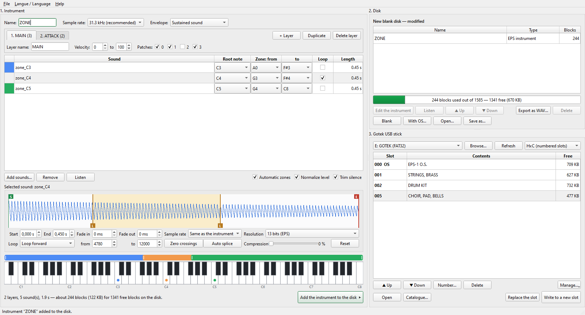

# EPS Builder

*[Version française](README.fr.md)*

   
  Ensoniq EPS — photo by Johnrpenner, <a href="https://commons.wikimedia.org/wiki/File:Ensoniq_EPS_Photo.jpg">Wikimedia Commons</a>,
  <a href="https://creativecommons.org/licenses/by-sa/3.0/">CC BY-SA 3.0</a>

EPS Builder turns audio files into instruments for the **Ensoniq EPS** sampler, stores them on
virtual floppy disks (`.hfe`) and manages the USB stick of a **Gotek** drive (HxC or FlashFloppy
firmware). Instruments are written in the EPS classic format, which the EPS-16+ and the ASR-10
can also read.

The application is available in English and French (menu *Langue / Language*).

**Download:** the ready-to-run Windows application (`EPSBuilder.exe`, no installation needed) is
attached to the [v0.4.1 release](https://github.com/ChristopheCruz/EPSPatchBuilder/releases/tag/v0.4.1).

## The Ensoniq EPS

The **EPS** (*Ensoniq Performance Sampler*) is a sampling keyboard built by Ensoniq in Malvern,
Pennsylvania, from 1988 to 1991, as the successor to the Mirage. It earned the word
"Performance" in its name with a feature that was rare at the time: new sounds can be loaded
from disk while you keep playing the ones already in memory.

| | |
|---|---|
| **Sampling** | 13-bit, mono input, sample rates from 6.25 kHz to 52 kHz |
| **Polyphony** | 20 voices at 31.2 kHz, 16 at 39 kHz, 12 at 52 kHz |
| **Keyboard** | 61 keys, velocity and polyphonic aftertouch, two patch-select buttons |
| **Instruments** | 8 loaded at once, each with up to 8 layers and 127 wavesamples |
| **Per-sound synthesis** | two filters, three envelopes (pitch, filter, amplitude), LFO, assignable modulation sources |
| **Memory** | 256 K sample words, expandable with 2x and 4x expanders |
| **Storage** | 3.5" double-density floppy disks of 800 KB; SCSI with an expander |
| **Also on board** | 8-track sequencer, MIDI in/out/thru |
| **Operating system** | loaded from floppy at power-up; last version 2.49 |

Its 13-bit converters give the EPS a gritty, slightly crunchy character that is still sought
after today. It was followed by the 16-bit **EPS-16 Plus** and, in 1992, by the **ASR-10**, both
of which read EPS disks — the original model is now often called the "EPS classic".

Thirty-five years on, the weak point of these machines is the floppy drive. A **Gotek** floppy
emulator replaces it with a USB stick holding disk images, and EPS Builder is the missing link
between today's audio files and that stick.

## Features

- **Instrument editor**: drag and drop WAV, AIFF, FLAC, MP3 or OGG files (M4A, WMA and others
  if ffmpeg is installed). The root note is read from the file name (`piano_C3.wav`).
- **Key zones**: automatic split between root notes, or drag the zone edges on the keyboard.
- **Sound editor**: waveform with start, end and loop markers, fades, per-sound sample rate,
  bit reduction, dynamic compression, zero-crossing snap and automatic loop splice.
- **Listening**: play a sound, or click a key to hear the instrument at that note (Windows).
- **Disk**: add, delete, reorder and edit the instruments of a disk image; export sounds as WAV;
  create a bootable disk by copying the OS from an existing one.
- **USB stick**: lists the slots of a Gotek stick with their contents, writes disks with
  read-back verification, copies instruments between slots by drag and drop, text catalogue.

## Example disk

[`floppy disks/gameboy+os.hfe`](floppy%20disks/gameboy%2Bos.hfe) is a disk made entirely with EPS Builder. It shows
what an edited instrument looks like and can be used to try the program without preparing any
sound.

The disk is bootable: it holds the EPS operating system and one instrument, **GAME BOY**, a
chiptune drum and effects kit built from seven short sounds spread over the keyboard.

| Sound | Root note | Key zone | Length | Loop |
|---|---|---|---|---|
| HIHAT | F#1 | A0 – A1 | 0.04 s | – |
| KICK | C#2 | A#1 – G2 | 0.24 s | – |
| OPENHAT | C#3 | G#2 – F#3 | 0.15 s | – |
| PERC | B3 | G3 – F#4 | 0.08 s | – |
| PULSE | D5 | G4 – E5 | 0.07 s | – |
| SFX | G5 | F5 – A5 | 0.16 s | back and forth |
| SNARE | C6 | A#5 – C8 | 0.09 s | – |

All sounds are stored at 15.6 kHz, so the whole instrument takes 58 blocks (about 29 KB) and
leaves 1360 blocks free on the disk.

**To explore it in EPS Builder:** *File → Open a disk image…*, then double-click **GAME BOY**.
The seven sounds appear in the editor with their zones on the keyboard; select one to see its
waveform, move its start, end or loop markers, click a key to hear it, then press *Update the
instrument on the disk*.

**To play it on an EPS:** copy the file to the Gotek USB stick under the next free slot name
(for example `DSKA0021.hfe` with the HxC firmware), or open it in EPS Builder and use *Write to
a new slot*. The EPS can boot directly from this slot.

This disk image is not covered by the MIT licence: it contains the EPS operating system 2.49,
which belongs to Ensoniq, and sound samples that remain the property of their authors.

## Building the Windows application

A prebuilt `EPSBuilder.exe` is available on the [release page](https://github.com/ChristopheCruz/EPSPatchBuilder/releases/tag/v0.4.1); build it yourself
only if you want to modify the program.

Double-click `build_windows.bat`. The script installs the dependencies in a `.venv` folder,
runs the tests, then produces `dist\EPSBuilder.exe`. Python 3.10 or later and an Internet
connection are needed the first time.

To run without building: `pip install -r requirements.txt`, then `python -m epsbuilder`.

## Quick start

1. Drag audio files into the "Instrument" list, check each root note, name the instrument.
2. Click "Add the instrument to the disk".
3. Choose the Gotek USB stick and click "Write to a new slot".
4. Eject the stick, plug it into the Gotek, boot the EPS from the slot that holds the OS, then
   select the new slot and load the instrument.

The full manual is in [`epsbuilder/MANUAL.md`](epsbuilder/MANUAL.md)
([French](epsbuilder/MANUEL.md)) and in the application's Help menu.

## Command line

    python -m epsbuilder info -d DSKA0000.hfe
    python -m epsbuilder build -o DSKA0001.hfe -n "MY PIANO" piano_C2.wav@C2 piano_C4.wav@C4
    python -m epsbuilder extract DSKA0000.hfe wav_folder

## Code layout

| File | Role |
|---|---|
| `epsbuilder/gui.py` | graphical interface (PySide6) |
| `epsbuilder/soundedit.py` | sound editor: waveform, trimming, loop |
| `epsbuilder/usbkey.py` | USB stick: slots, verified writes, catalogue |
| `epsbuilder/project.py` | audio file → instrument → disk pipeline |
| `epsbuilder/instrument.py` | EPS instrument format (layers, wavesamples, zones, loops, envelope) |
| `epsbuilder/disk.py` | Ensoniq file system (directory, allocation table) |
| `epsbuilder/hfe.py` | HFE reading and writing (MFM) |
| `epsbuilder/audio.py` | audio reading, mono mix, resampling, level, compression |
| `epsbuilder/i18n.py`, `translations.py` | French and English texts |
| `tests/test_epsbuilder.py` | automated tests |

## Status and limits

- Tested on a real EPS classic (OS 2.49) with a Gotek running the HxC firmware.
- EPS classic format only (13 bits, 800 KB disks). The native EPS-16+ and ASR-10 formats are
  not written, and FlashFloppy naming has not been tested on hardware.
- One layer per created instrument. Detailed envelopes, filter and LFO are set on the EPS.

## Support

EPS Builder is free. If it is useful to you and you would like to support its development, you
can [buy me a coffee](https://buymeacoffee.com/christophecruz).

## Licence

Free software under the [MIT licence](LICENSE) — © 2026 Christophe CRUZ.

Ensoniq, EPS and ASR-10 are trademarks of their respective owners; this project is not
affiliated with any manufacturer. The file format was worked out from disks written by an EPS
and from the Ensoniq *EPS External Command Specification*.

The photograph of the EPS at the top of this page is by Johnrpenner (Wikimedia Commons) and is
licensed separately under CC BY-SA 3.0; it is not covered by the MIT licence. Background on the
instrument: [Wikipedia](https://en.wikipedia.org/wiki/Ensoniq_EPS),
[Vintage Synth Explorer](https://www.vintagesynth.com/ensoniq/eps),
[Sound On Sound, February 1988](https://www.muzines.co.uk/articles/ensoniq-performance-sampler/3471).
